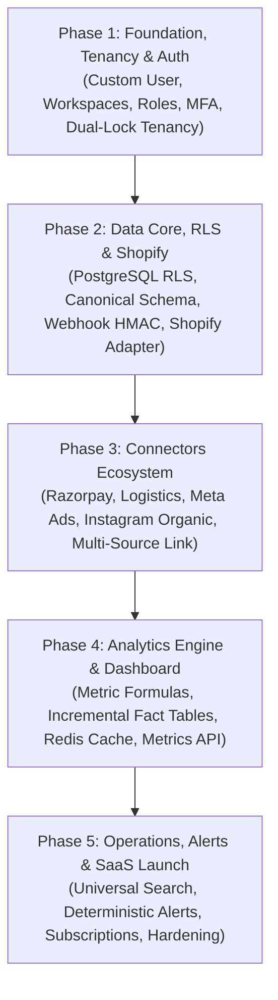

# 125 East Commerce Intelligence: Master Architecture & Learning Roadmap

Welcome to your engineering journey. You are building **125 East Commerce Intelligence**, a production-grade multi-tenant B2B SaaS platform that unifies e-commerce operations across Shopify, Razorpay, Logistics (e.g., Shiprocket), Meta Ads, and Instagram Organic into a single real-time intelligence hub.

---

## 1. The Strategy: AI Frontend + Self-Built Backend

| Layer | Responsibility | Your Learning Focus |
|---|---|---|
| **Frontend (Next.js App Router)** | Generative AI / Agent-built UI components, Tailwind CSS, Recharts, TanStack Query. | Understanding the OpenAPI / JSON contract, defining clean DTOs, and consuming API errors cleanly. |
| **Backend (Django + DRF + Celery + Postgres)** | Built by **YOU** step-by-step. | Multi-tenancy architecture, PostgreSQL Row-Level Security (RLS), OAuth 2.0 flows, secure webhook ingestion, financial math, distributed task queues, and deterministic analytics. |

---

## 2. System Architecture at a Glance

```
                                      +------------------------------------+
                                      |          Next.js Frontend          |
                                      |   (AI-generated, TanStack Query)   |
                                      +-----------------+------------------+
                                                        |
                                                        | HTTPS / Session Cookie
                                                        v
                                      +-----------------+------------------+
                                      |         Django DRF API             |
                                      |  (Modular Monolith, Tenant Context)|
                                      +--------+------------------+--------+
                                               |                  |
                       +-----------------------+                  +----------------------+
                       |                                                                 |
                       v                                                                 v
        +--------------+---------------+                                  +--------------+---------------+
        |   PostgreSQL 16 Database     |                                  |   Redis + Celery Workers     |
        | - Tenant Isolation (RLS)     |                                  | - Webhook Ingestion Queue    |
        | - Canonical Tables (Orders)  |                                  | - Async Integration Syncs    |
        | - Fact Rollups (Daily KPIs)  |                                  | - Fact Rollup Aggregations   |
        +------------------------------+                                  | - Deterministic Alert Engine |
                                                                          +--------------+---------------+
                                                                                         |
                                           +---------------------------------------------+
                                           | Outbound API Sync & Webhooks
                                           v
       +---------------------------------------------------------------------------------------+
       |   Shopify Partner API   |   Razorpay Gateway   |   Logistics (Shiprocket)   |  Meta   |
       +---------------------------------------------------------------------------------------+
```

---

## 3. High-Level Monorepo Structure

```
125east-ci/
├── apps/
│   └── web/                   # Next.js App Router frontend (AI generated)
├── backend/                   # Django modular monolith (Built by you)
│   ├── config/                # Settings (base.py, dev.py, prod.py, urls.py)
│   ├── apps/
│   │   ├── accounts/          # Custom User, Session Auth, MFA (TOTP), Recovery Codes
│   │   ├── tenancy/           # Workspace, Brand, Memberships, TenantManager, RLS Middleware
│   │   ├── integrations/      # Base ProviderAdapter, Shopify, Razorpay, Logistics, Meta
│   │   ├── commerce/          # Canonical Order, Customer, PaymentAttempt, Shipment, Links
│   │   ├── analytics/         # MetricCatalogue, daily fact tables, formula engine, API
│   │   ├── alerts/            # Deterministic alert rules, dedupe keys, notifications
│   │   └── billing/           # Subscriptions, usage counters, tier limits
├── infra/                     # Docker Compose (Postgres, Redis, Backend, Celery Worker, Beat)
└── appflow/
    └── phases/                # Your 5-phase breakdown and self-learning guides
```

---

## 4. Phase Breakdown & Progression

Each phase represents an isolated, test-driven milestone with strict exit gates:



### Detailed Phase Navigation

1. [**Phase 1 Guide: Foundation, Tenancy, and Authentication**](./01_PHASE_1_FOUNDATION_TENANCY_AUTH.md)
   - *Core Concept:* Multi-tenancy mental model, custom User model, Django request lifecycle, RBAC, TOTP MFA, and session security.
   - *Exit Gate:* Pytest proves User A receives a `404` for Workspace B resources; MFA is enforced for Admins.

2. [**Phase 2 Guide: Data Core, Row-Level Security (RLS) & Shopify**](./02_PHASE_2_DATA_CORE_RLS_SHOPIFY.md)
   - *Core Concept:* PostgreSQL RLS policies with `app_user` vs `migrator`, canonical e-commerce schema, paise/minor currency units, ProviderAdapter pattern, Shopify HMAC validation, and Celery deduplication.
   - *Exit Gate:* Database RLS strictly isolates rows; Shopify backfill and webhooks sync cleanly without duplicates.

3. [**Phase 3 Guide: Connectors Ecosystem (Razorpay, Logistics, Meta)**](./03_PHASE_3_CONNECTORS_ECOSYSTEM.md)
   - *Core Concept:* Payment gateway reconciliation, logistics state machine normalization, Meta Graph API batching & 28-day conversion restatement, envelope encryption with KMS.
   - *Exit Gate:* All 5 sources connected for 125 East; order detail links 1 order to $N$ payments and $M$ shipments.

4. [**Phase 4 Guide: Analytics Engine, Fact Rollups & Metrics API**](./04_PHASE_4_ANALYTICS_METRICS_ENGINE.md)
   - *Core Concept:* Deterministic metric formulas (ratio of sums vs sum of ratios), incremental daily fact rollups, brand-timezone boundaries, typed OpenAPI schemas for the frontend.
   - *Exit Gate:* Mathematical verification tests match Shopify/Razorpay reports; tenant-isolated Redis caching.

5. [**Phase 5 Guide: Operations, Alerts, Hardening & SaaS Launch**](./05_PHASE_5_OPS_ALERTS_SAAS_LAUNCH.md)
   - *Core Concept:* Trigram indexing for cross-platform order search, deterministic alert engine with deduplication keys, background CSV exports, subscription limits, and Indian DPDP compliance.
   - *Exit Gate:* Security pentest pass, automated backup restore drill, self-onboarding tested without manual intervention.

---

## 5. Learning Philosophy: How to Learn Along the Way

As you build this backend, adhere to the **3-Tier Rule**:
1. **Understand the "Why":** Never write a model or middleware without understanding what attack vector or operational issue it prevents (e.g., ID guessing, tenant data leakage, float rounding errors).
2. **Build with Dummy Data First:** Never touch production or live third-party accounts until unit tests and mock data confirm system behavior.
3. **Verify via Pytest:** If you haven't written an automated test for a feature, it isn't built. Write the test first or immediately after implementing the view or task.
