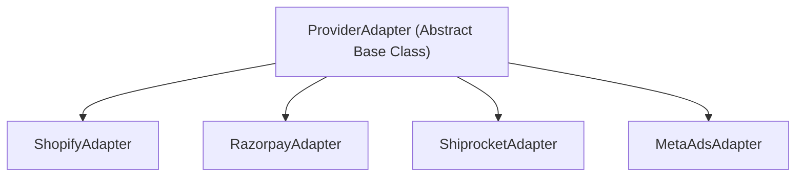

# Phase 2: Data Core, Row-Level Security (RLS) & Shopify

## Overview & Goal
Build the canonical e-commerce core locked down by PostgreSQL Row-Level Security (RLS), design the generic `ProviderAdapter` framework, and implement the first live connector: **Shopify**.

By the end of this phase, Shopify catalog, customer, order, and fulfillment data will sync via backfill and secure webhooks for a test brand without any chance of data leaking across workspaces.

---

## 1. Core Mental Models & Concepts to Learn

### A. The Two Database Roles: `migrator` vs `app_user`
This is one of the most critical security patterns in production SaaS:
- **The Problem:** In PostgreSQL, the owner of a table and superusers automatically bypass Row-Level Security by default. If your Django app connects as the table owner, RLS policies are completely ignored!
- **The Solution:** Two distinct PostgreSQL users:
  1. `migrator`: Owns the database and tables. Runs `python manage.py migrate`. Never used by the running web application.
  2. `app_user`: Has `NOBYPASSRLS`. Only has `SELECT, INSERT, UPDATE, DELETE` permissions. The Django web app and Celery workers connect **strictly as `app_user`**.

### B. `SET LOCAL app.workspace_id` in Transactions
How do we tell PostgreSQL which tenant is making a query?
- When a web request starts, Django sets a session setting in Postgres:
  ```sql
  SET LOCAL app.workspace_id = 'c1f7a0b3-4f9e-...';
  ```
- **Why `SET LOCAL`?** A `SET LOCAL` setting only persists for the duration of the current database transaction (`BEGIN ... COMMIT`). Once the transaction completes, it automatically clears. This makes it completely safe to use with **PgBouncer** connection pooling in transaction mode!
- If a query runs without `app.workspace_id` set, the RLS policy evaluates to false and returns **0 rows** instead of leaking data.

### C. Financial Precision: Why Integer Minor Units (Paise/Cents)?
- In Python and JavaScript, `0.1 + 0.2 = 0.30000000000000004` due to IEEE-754 floating point representation.
- In financial and commerce applications, **NEVER use `FloatField`**.
- Store all monetary values as **integer paise** (minor currency units):
  - ₹100.50 is stored as `10050`
  - $24.99 is stored as `2499`
  - Pair every amount field with a 3-letter ISO `currency` code (`INR`, `USD`).

### D. Composite Foreign Keys for Tenant Integrity
In relational databases, if you have an `Order` and a `Payment`, a standard foreign key only checks if `payment.order_id` exists. It doesn't guarantee that the payment and order belong to the same brand!
- By including composite constraints on `(workspace_id, brand_id, id)`, the database physically prevents brand A's order from linking to brand B's payment attempt.

### E. The `ProviderAdapter` Pattern
Instead of writing scattered scripts for each provider, define an abstract interface that all connectors (Shopify, Razorpay, Logistics, Meta) must implement:



---

## 2. Step-by-Step Implementation Guide

### Step 1: PostgreSQL RLS Configuration
Create a custom Django migration to configure roles and enable RLS:

```python
# apps/tenancy/migrations/0002_enable_rls.py
from django.db import migrations

class Migration(migrations.Migration):
    dependencies = [('tenancy', '0001_initial')]

    operations = [
        migrations.RunSQL(
            sql="""
            -- Create app user role if not exists
            DO $$
            BEGIN
                IF NOT EXISTS (SELECT FROM pg_catalog.pg_roles WHERE rolname = 'app_user') THEN
                    CREATE ROLE app_user LOGIN PASSWORD 'app_secure_password' NOBYPASSRLS;
                END IF;
            END
            $$;
            
            GRANT USAGE ON SCHEMA public TO app_user;
            GRANT SELECT, INSERT, UPDATE, DELETE ON ALL TABLES IN SCHEMA public TO app_user;
            ALTER DEFAULT PRIVILEGES IN SCHEMA public GRANT SELECT, INSERT, UPDATE, DELETE ON TABLES TO app_user;
            """,
            reverse_sql="-- Dropping roles requires manual DBA intervention"
        )
    ]
```

For every tenant table (orders, customers, payments, etc.), apply the RLS policy:
```sql
ALTER TABLE commerce_order ENABLE ROW LEVEL SECURITY;
ALTER TABLE commerce_order FORCE ROW LEVEL SECURITY;

CREATE POLICY tenant_isolation_policy ON commerce_order
    FOR ALL
    TO app_user
    USING (workspace_id = NULLIF(current_setting('app.workspace_id', true), '')::uuid);
```

### Step 2: Database RLS Middleware
```python
# apps/tenancy/rls_middleware.py
from django.db import connection

class RLSMiddleware:
    def __init__(self, get_response):
        self.get_response = get_response

    def __call__(self, request):
        # ATOMIC_REQUESTS is active: request runs inside a transaction
        if hasattr(request, 'tenant') and request.tenant and request.tenant.workspace:
            with connection.cursor() as cursor:
                cursor.execute(
                    "SET LOCAL app.workspace_id = %s;",
                    [str(request.tenant.workspace.id)]
                )
        return self.get_response(request)
```

### Step 3: Canonical Commerce Models (`apps/commerce/models.py`)
```python
# apps/commerce/models.py
import uuid
from django.db import models

class CanonicalBaseModel(models.Model):
    id = models.UUIDField(primary_key=True, default=uuid.uuid4, editable=False)
    workspace = models.ForeignKey('tenancy.Workspace', on_delete=models.CASCADE)
    brand = models.ForeignKey('tenancy.Brand', on_delete=models.CASCADE)
    provider = models.CharField(max_length=50) # 'shopify', 'razorpay', etc.
    provider_id = models.CharField(max_length=255, db_index=True)
    source_created_at = models.DateTimeField(null=True, blank=True)
    source_updated_at = models.DateTimeField(null=True, blank=True)
    ingested_at = models.DateTimeField(auto_now_add=True)

    class Meta:
        abstract = True
        unique_together = ('brand', 'provider', 'provider_id')

class Order(CanonicalBaseModel):
    order_number = models.CharField(max_length=100)
    customer_id = models.UUIDField(null=True, blank=True)
    currency = models.CharField(max_length=3, default='INR')
    
    # Financial fields stored as integer paise (minor units)
    gross_amount = models.BigIntegerField(default=0) # Total before discounts
    discount_amount = models.BigIntegerField(default=0)
    tax_amount = models.BigIntegerField(default=0)
    net_sales = models.BigIntegerField(default=0)    # gross - discount - tax
    
    financial_status = models.CharField(max_length=50) # paid, pending, refunded
    fulfillment_status = models.CharField(max_length=50) # fulfilled, unfulfilled, partial
    cancelled_at = models.DateTimeField(null=True, blank=True)
```

### Step 4: The Provider Adapter Interface (`apps/integrations/base.py`)
```python
# apps/integrations/base.py
from abc import ABC, abstractmethod
from typing import Iterator, Dict, Any

class ProviderAdapter(ABC):
    def __init__(self, integration_record):
        self.integration = integration_record

    @abstractmethod
    def get_auth_url(self, state: str) -> str:
        """Returns OAuth authorization URL."""
        pass

    @abstractmethod
    def exchange_code(self, code: str) -> Dict[str, Any]:
        """Exchanges authorization code for access token."""
        pass

    @abstractmethod
    def verify_webhook(self, headers: Dict[str, str], raw_body: bytes) -> bool:
        """Cryptographically verifies incoming webhook payload."""
        pass

    @abstractmethod
    def normalize_order(self, raw_payload: Dict[str, Any]) -> Dict[str, Any]:
        """Transforms provider-specific payload into Canonical Order fields."""
        pass
```

### Step 5: Shopify Connector & Webhook Ingestion
1. **Webhook Security:** Shopify signs every webhook body with HMAC-SHA256 using your App Secret.
   ```python
   # apps/integrations/shopify/adapter.py
   import hmac
   import hashlib
   import base64

   class ShopifyAdapter(ProviderAdapter):
       def verify_webhook(self, headers: dict, raw_body: bytes) -> bool:
           hmac_header = headers.get('X-Shopify-Hmac-Sha256')
           if not hmac_header:
               return False
           digest = hmac.new(
               self.integration.get_decrypted_secret().encode('utf-8'),
               raw_body,
               hashlib.sha256
           ).digest()
           calculated_hmac = base64.b64encode(digest).decode('utf-8')
           return hmac.compare_digest(calculated_hmac, hmac_header)
   ```
2. **Fast 200 Ingestion Pattern:**
   - Webhook endpoint immediately saves raw body to `WebhookEvent(provider='shopify', payload=raw_body, processed=False)`.
   - Returns HTTP 200 within 200ms (preventing Shopify webhook timeouts and retries).
   - Fires a Celery task `process_shopify_webhook.delay(event_id)`.

### Step 6: `seed_demo` Management Command
Create `backend/apps/commerce/management/commands/seed_demo.py`:
- Generates 2 dummy Workspaces ("125 East Demo", "Acme Retail")
- Generates 3 Brands with 6 months of daily orders, payments, and shipments
- Allows the frontend team (or AI building the UI) to construct charts and KPI displays immediately with realistic demo data!

---

## 3. What the AI Frontend Needs (API Contract)

### 1. Integration Status Endpoints
- `GET /api/w/{ws}/b/{brand}/integrations/`
  ```json
  [
    {
      "provider": "shopify",
      "status": "connected",
      "shop_url": "125east.myshopify.com",
      "last_synced_at": "2026-11-10T08:00:00Z",
      "sync_in_progress": false
    }
  ]
  ```
- `POST /api/w/{ws}/b/{brand}/integrations/shopify/connect/` -> Initiates OAuth URL redirect
- `POST /api/w/{ws}/b/{brand}/integrations/shopify/sync-now/` -> Triggers Celery backfill job

---

## 4. Verification & Exit Gate Checklist

- [ ] **RLS Raw Query Verification:**
  Connect to Postgres as `app_user`:
  ```sql
  SET LOCAL app.workspace_id = '00000000-0000-0000-0000-000000000001';
  SELECT count(*) FROM commerce_order; -- Returns only workspace 1 rows
  SET LOCAL app.workspace_id = '00000000-0000-0000-0000-000000000002';
  SELECT count(*) FROM commerce_order; -- Returns only workspace 2 rows
  ```
- [ ] **Webhook Signature Verification:** A webhook call with a tampered body or forged HMAC is rejected with HTTP 401 and logged.
- [ ] **Sync Idempotency:** Running `sync_shopify_orders` twice yields the exact same record count without duplicate rows (`ON CONFLICT DO UPDATE`).
- [ ] **Minor Unit Accuracy:** Verify all order values are stored in integer paise with no rounding drift.
