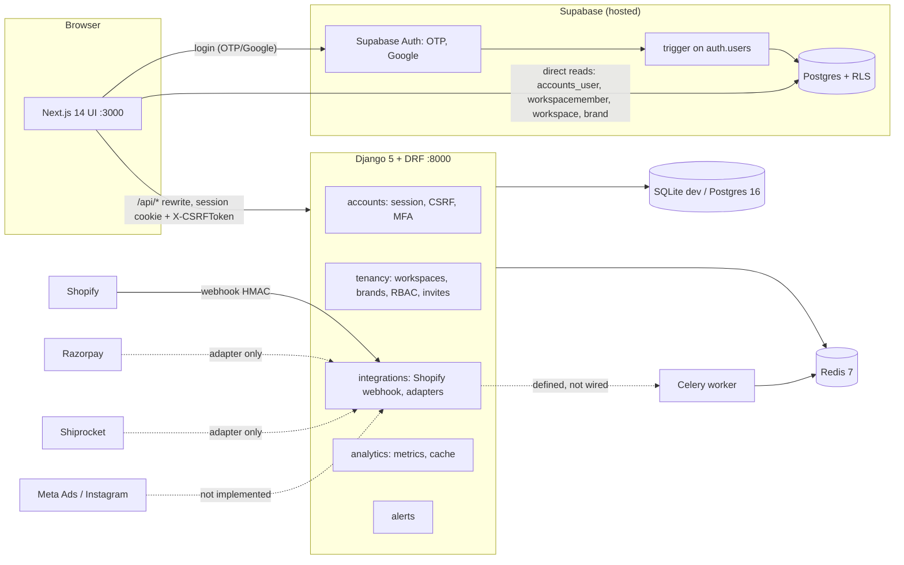

# Architecture

## Diagram

Solid lines exist in code. Dotted lines are partial or planned.

## Two parallel identity and data systems (key architectural fact)
1. **Supabase path.** The frontend signs users in with Supabase Auth and reads profile, workspaces and brands **directly from Supabase tables** with the anon key. A trigger on `auth.users` (`..._009`) creates the `accounts_user` row and provisions a workspace and brand, or applies a pending invite.
2. **Django path.** All business APIs live in Django and authenticate with a **Django session cookie** (`SessionAuthentication` only). Django also has its own email and password login, register and TOTP MFA endpoints.

The code contains **no bridge** between them: no JWT or Supabase-token authentication class in DRF, and no frontend call to `/api/auth/login`. Whether a Supabase login yields a usable Django session is unresolved and is the first item to verify in Phase 2. The same table definitions exist twice (Django migrations and Supabase SQL), so there are two schema sources of truth.

## Backend modules (`backend/apps`)
| App | Role | State |
|---|---|---|
| `accounts` | Custom `User` (UUID pk, email login), `MFARecoveryCode`, register, login, MFA, `me`, CSRF | Working, tested |
| `tenancy` | `Workspace`, `WorkspaceMember` (owner/admin/analyst/viewer), `Brand`, `BrandMember`, `Invite`, `AuditLog`; `TenancyMiddleware`; permission classes; `TenantManager` | Working, tested |
| `integrations` | `Integration`, `RawPayload`, `SyncRun`, `SyncCursor`, `WebhookEvent`; `ProviderAdapter` ABC; Shopify, Razorpay, Shiprocket adapters; AES-GCM crypto; Celery task | Shopify path only |
| `commerce` | Canonical `Customer`, `Product`, `ProductVariant`, `Order`, `OrderLine`, `PaymentAttempt`, `Shipment`, `TrackingEvent`, order-payment and order-shipment links; `seed_demo` command | Models only; no API |
| `analytics` | `FactShopDaily`, `FactAdsDaily` (unused), metric catalogue (9 formulas), tenant cache, metrics API | Partly simulated |
| `alerts` | `Alert` with dedupe key; list, acknowledge, resolve endpoints | No alert generator found |
| `billing` | Empty app | Not started |

## Request flow: tenant resolution
`/api/w/<workspace_slug>/...` goes through `TenancyMiddleware.process_view`, which resolves the user's `WorkspaceMember` and optional `BrandMember` restrictions into `request.tenant`. A non-member gets 404 (not 403) to avoid tenant enumeration. DRF permission classes `HasTenantAccess`, `IsWorkspaceAdmin`, `IsWorkspaceOwner`, `IsWorkspaceAnalyst` build on it. `RLSMiddleware` (sets `app.workspace_id` for Postgres RLS) exists but is **not listed in `MIDDLEWARE`**.

## Shopify ingestion flow
Shopify -> `POST /api/webhooks/shopify/<brand_id>/` (CSRF-exempt, `AllowAny`) -> HMAC check against decrypted per-brand secret -> dedupe on `X-Shopify-Webhook-Id` -> insert `WebhookEvent` -> **starts a daemon Python thread** running `process_webhook_event_task` (Celery is configured but `.delay()` is not used) -> `ingest_shopify_order` (upsert customer and order, replace lines, store `RawPayload`) -> invalidate brand cache.

## Data model summary
- All tenant tables carry `workspace_id` (via `TenantAwareModel`); canonical commerce rows also carry `brand_id`, `provider`, `provider_id`, with unique `(brand, provider, provider_id)`.
- Money fields are `BigInteger` paise. `net_sales = gross - discount - tax`.
- Unique constraints: `(workspace, user)` membership, `(brand, user)`, `(brand, provider)` integration, `(integration, resource)` cursor, `event_id` on webhook events, `(workspace, dedupe_key)` on alerts, `(brand, fact_date)` on facts.
- Supabase SQL adds: partitioned `rawpayload` and `webhookevent` (monthly 2026-10..12 plus default), pg_trgm indexes for order, phone, email, AWB search, covering and keyset indexes, a `billing_subscription` table (no Django model), RPC `get_brand_commerce_stats`, `refresh_daily_fact_shop`, and an `app_user` role (`NOBYPASSRLS`).
- RLS: enabled on all 26 tables with one policy each. Policies accept either the session variable `app.workspace_id` (Django path) or `auth.uid()` membership (Supabase path).

## Authentication, authorization, boundaries
- Roles per workspace: owner > admin > analyst > viewer. `TenantContext` exposes `is_owner`, `is_admin`, `is_analyst`.
- Optional per-brand restriction through `BrandMember`.
- Admin-only: create brand, list members, create invite. Everything else under a tenant needs only membership (`HasTenantAccess`).
- MFA: TOTP with 10 single-use recovery codes (SHA-256). Opt-in; not enforced by role.
- Sessions: HttpOnly cookie, SameSite=Lax, 7 days; CSRF cookie readable by JS for `X-CSRFToken`.

## Infrastructure and dependencies
| Item | Status |
|---|---|
| Postgres 16 | `infra/docker-compose.yml` (db `commerce_intel`, port 5432) and Supabase |
| Redis 7 | docker-compose; used for cache, sessions, Celery when `REDIS_URL` set |
| Celery worker or beat | Not defined in docker-compose; no beat schedule found |
| Backend and frontend containers | None; no Dockerfiles |
| CI/CD, hosting, object storage, email sending | None found |
| External APIs called at runtime | HaveIBeenPwned range API (registration), Supabase Auth |
| Local dev DB | SQLite (`DATABASE_URL` is sqlite), so RLS and Postgres-only features are not exercised locally |

## Environment configuration (values not printed)
`backend/.env` keys: `DEBUG`, `SECRET_KEY`, `ALLOWED_HOSTS`, `DATABASE_URL`, `REDIS_URL`, `CORS_ALLOWED_ORIGINS`, `SESSION_COOKIE_DOMAIN`, `CSRF_COOKIE_DOMAIN`, `CELERY_BROKER_URL`, `CELERY_RESULT_BACKEND`. `frontend/.env.local` keys: `NEXT_PUBLIC_SUPABASE_URL`, `NEXT_PUBLIC_SUPABASE_ANON_KEY`.
Observations: `DEBUG=True`; `REDIS_URL` is empty (so LocMem cache, DB sessions); `CORS_ALLOWED_ORIGINS` in `.env` is not read by `dev.py` (`CORS_ALLOW_ALL_ORIGINS=True`); `prod.py` sets no CORS, hosts or CSRF origins; `SECRET_KEY` has an insecure default fallback and also derives the credential-encryption key. `supabaseClient.ts` has hardcoded fallback URL and anon key if env vars are missing.

## Existing tests
29 pytest tests in `backend/tests/` across 7 files: auth and MFA (5), invites and RBAC (3), tenancy isolation (4), Shopify dashboard (4), Razorpay and logistics (3), metrics formulas (7), alerts (3). No frontend tests, no e2e tests, no load or security tests, and no Postgres or RLS tests. `.pytest_cache` shows no failures.
