# DATABASE_RELATIONSHIP_DIAGRAM — Phase 3

Every table below also carries `workspace_id → tenancy_workspace` and `brand_id → tenancy_brand` (omitted for readability). ★ = new in Phase 3.

```mermaid
erDiagram
    tenancy_workspace ||--o{ tenancy_brand : has
    tenancy_workspace ||--o{ tenancy_workspacemember : has
    accounts_user ||--o{ tenancy_workspacemember : "is member"
    tenancy_brand ||--o{ integrations_integration : "one per provider"

    integrations_integration ||--o{ integrations_syncrun : "sync history"
    integrations_integration ||--o{ integrations_synccursor : "checkpoint per resource"
    tenancy_brand ||--o{ integrations_webhookevent : "signed deliveries"
    tenancy_brand ||--o{ integrations_rawpayload : "raw layer (extended)"
    integrations_rawpayload_dedupe |o--|| integrations_rawpayload : "★ hash -> row"

    commerce_customer ||--o{ commerce_order : places
    commerce_order ||--|{ commerce_orderline : contains
    commerce_productvariant |o--o{ commerce_orderline : "matched by provider_variant_id"
    commerce_product ||--|{ commerce_productvariant : has
    commerce_order ||--o{ commerce_order_history : "★ change log (trigger)"
    commerce_order ||--o{ commerce_refund : "★ refunds"
    commerce_paymentattempt |o--o{ commerce_refund : "★ refunds (Razorpay)"

    commerce_order ||--o{ commerce_orderpaymentlink : ""
    commerce_paymentattempt ||--o{ commerce_orderpaymentlink : "exact-id links only"
    commerce_order ||--o{ commerce_ordershipmentlink : ""
    commerce_shipment ||--o{ commerce_ordershipmentlink : "by courier order ref"
    commerce_shipment ||--o{ commerce_trackingevent : "append-only scans"

    commerce_reconciliation }o--|| commerce_order : "★ matched_order_id"
    data_quality_issue }o--|| tenancy_brand : "★ open/resolved issues"

    analytics_ga4_transaction }o..o| commerce_order : "★ transaction_id = order id/number"
    tenancy_brand ||--o{ analytics_factshopdaily : "daily facts"
    tenancy_brand ||--o{ analytics_factadsdaily : "account-level ads (dashboard)"
    tenancy_brand ||--o{ analytics_meta_ad_daily : "★ ad-level paid"
    analytics_instagram_media ||--o{ analytics_instagram_media_snapshot : "★ organic, per day"
    tenancy_brand ||--o{ analytics_ga4_daily : "★ GA4 sessions"
```



## Natural keys (idempotency)
| Table | Unique key |
|---|---|
| commerce_customer / product / productvariant / order / paymentattempt / shipment / ★refund | `(brand_id, provider, provider_id)` |
| commerce_orderpaymentlink / ordershipmentlink | `(order_id, payment_attempt_id)` / `(order_id, shipment_id)` |
| commerce_trackingevent ★ | `(shipment_id, occurred_at, raw_status, location)` |
| integrations_rawpayload_dedupe ★ | `(brand_id, provider, topic, entity_id, payload_hash)` |
| integrations_webhookevent | `(brand_id, provider, event_id, created_at)` + dedupe table |
| integrations_synccursor | `(integration_id, resource)` |
| integrations_syncrun ★ | one `running` row per `(integration_id, resource)` (partial unique index) |
| analytics_meta_ad_daily ★ | `(brand_id, ad_id, report_date, attribution_setting)` |
| analytics_instagram_media ★ / _snapshot ★ | `(brand_id, media_id)` / `(brand_id, media_id, snapshot_date)` |
| analytics_ga4_daily ★ | `(brand_id, property_id, report_date, source, medium, campaign, landing_page, device)` |
| analytics_ga4_transaction ★ | `(brand_id, property_id, transaction_id)` |
| commerce_reconciliation ★ | `(entity_type, entity_id)` |
| data_quality_issue ★ | `(brand_id, check_key, entity_table, entity_id)` |

## Data flow
```
Shopify / Razorpay  ── sync (cron or user) ─┐
                    ── signed webhook ──────┤
                                            ▼
                         integrations_rawpayload  (PII-minimised, hash-deduplicated, status)
                                            ▼  _shared/pipeline.ts (one path per entity)
              commerce_customer · order (+history) · orderline · refund · paymentattempt
                                            ▼  reconcile_brand()  (hourly cron, or after reprocess)
                  orderpaymentlink · ordershipmentlink · commerce_reconciliation
                                            ▼  run_data_quality_checks()
                                    data_quality_issue
```
