# 125East Multi-Tenant Super Admin Architecture & Security Specification

## 1. Executive Architecture Overview

The **125East Super Admin Dashboard** provides a centralized control plane for platform administrators to govern tenants, manage user access, configure per-user functional module permissions, inspect data ingestion flows, and monitor serverless edge functions.

```mermaid
flowchart TD
    subgraph Client ["Client Presentation Tier (Next.js 14)"]
        UI_USER["Standard User Dashboard (/dashboard, /shopify, etc.)"]
        UI_ADMIN["Super Admin Control Plane (/super-admin/*)"]
        GUARD["ModuleGuard (Client-side Route & Navigation Guard)"]
        AUTH_CTX["AuthContext (isSuperAdmin, hasModule, effectivePermissions)"]
    end

    subgraph Server ["Server-side API Gateway & Route Handlers"]
        SRV_ADMIN["verifySuperAdmin (JWT Verification + accounts_user check)"]
        SRV_PERMS["Module Permissions Engine (/api/super-admin/permissions)"]
        SRV_USER["User Administration API (/api/super-admin/users/*)"]
        SRV_TEL["System Telemetry APIs (workspaces, functions, webhooks)"]
        AUDIT["Immutable Audit Trail (admin_audit_logs)"]
    end

    subgraph Edge ["Supabase Serverless Edge Runtime (Deno 2.x)"]
        GATEWAY["Edge Functions Gateway (:54321)"]
        EDGE_AUTH["requireAuth & requireWorkspaceAccess"]
        EDGE_MOD["requireModuleAccess Guard"]
        FN_SHOPIFY["shopify-sync"]
        FN_RAZORPAY["razorpay-sync"]
        FN_META["meta-ads-sync"]
        FN_INSTA["instagram-sync"]
        FN_WH_SHOP["webhook-shopify"]
        FN_WH_RP["webhook-razorpay"]
    end

    subgraph DB ["PostgreSQL Database Tier (Supabase)"]
        PM["platform_modules (Catalog & Kill Switches)"]
        WMP["workspace_module_permissions (Workspace Baseline)"]
        UMP["user_module_permissions (Per-User Overrides)"]
        AL["admin_audit_logs (Immutable Ledger)"]
        RPC["public.get_user_effective_modules()"]
        ACCOUNTS["accounts_user (is_superuser, is_active)"]
        TENANCY["tenancy_workspace & tenancy_workspacemember"]
        INTEG["integrations_integration (Encrypted AES-256-GCM)"]
    end

    UI_ADMIN --> SRV_ADMIN
    SRV_ADMIN --> AUDIT
    SRV_ADMIN --> DB
    UI_USER --> GUARD
    GUARD --> AUTH_CTX
    AUTH_CTX --> RPC
    GATEWAY --> EDGE_AUTH
    EDGE_AUTH --> EDGE_MOD
    EDGE_MOD --> RPC
    EDGE_MOD --> FN_SHOPIFY
    EDGE_MOD --> FN_RAZORPAY
    EDGE_MOD --> FN_META
    EDGE_MOD --> FN_INSTA
```

---

## 2. Route Structure & Access Matrix

| Route | Purpose | Authorization Requirement |
|---|---|---|
| `/super-admin` | Platform Overview KPI Dashboard | Super Admin (`accounts_user.is_superuser = true`) |
| `/super-admin/users` | Global User Directory & Search | Super Admin |
| `/super-admin/users/[userId]` | Comprehensive 9-Tab User Dossier & Permission Editor | Super Admin |
| `/super-admin/workspaces` | Multi-Tenant Workspace & Brand Management | Super Admin |
| `/super-admin/modules` | Platform Module Catalog & Global Kill Switches | Super Admin |
| `/super-admin/integrations` | Cross-Tenant Integration Health & Credentials Status | Super Admin |
| `/super-admin/data-flows` | 5-Stage Data Pipeline Execution Telemetry | Super Admin |
| `/super-admin/functions` | Serverless Edge Function Deployment & Status | Super Admin |
| `/super-admin/webhooks` | Webhook Ingestion Log & HMAC Signature Audit | Super Admin |
| `/super-admin/database` | PostgreSQL Table Telemetry & Row Level Security | Super Admin |
| `/super-admin/audit-logs` | Immutable Administrative Action Trail | Super Admin |
| `/super-admin/settings` | Super Admin Security, TOTP 2FA, & Session Policies | Super Admin |

---

## 3. Defense-in-Depth Security Framework

1. **Client-Side:**
   - Navigation links in `DashboardShell` dynamically hide modules not granted to the user.
   - Any manual URL entry is intercepted by `<ModuleGuard>`, rendering a high-visibility "Access Restricted" alert and redirecting to the main dashboard.
2. **Server-Side API Routes:**
   - Every `/api/super-admin/*` route invokes `verifySuperAdmin(req)`.
   - The caller's Supabase JWT is cryptographically verified with `supabase.auth.getUser(token)`.
   - The user record in `accounts_user` is checked for `is_superuser = true` using a secure server-only service role client.
   - Non-superusers receive an immediate `HTTP 403 Forbidden` response.
3. **Edge Functions / Serverless Runtimes:**
   - `requireAuth()` verifies Bearer token validity.
   - `requireWorkspaceAccess()` ensures tenant membership.
   - `requireModuleAccess()` validates platform status, workspace baseline, and user override via stored procedure `get_user_effective_modules()`.
4. **PostgreSQL Row Level Security (RLS):**
   - Tables enforce tenant isolation by `workspace_id`.
   - Super Admins can query cross-tenant metadata via server-side elevation with mandatory audit log emission in `admin_audit_logs`.
